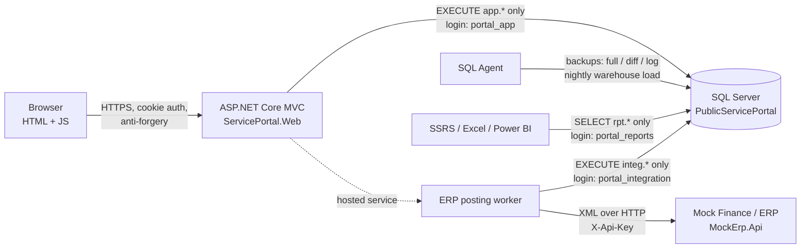
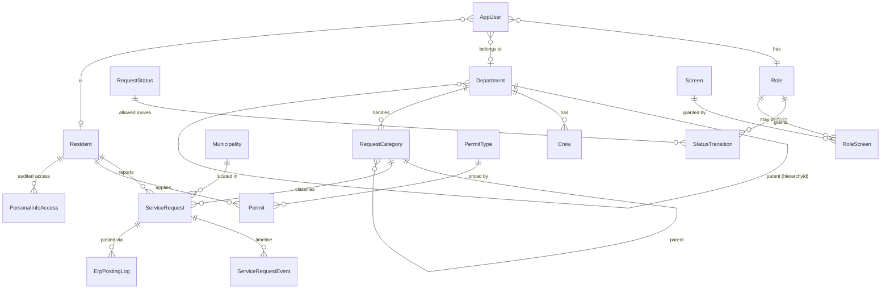

# Public Service Portal – Municipal Service Requests & Permits

A full-stack database application modelled on how an Ontario county handles resident service requests (potholes, signal outages, missed collection, by-law complaints) and building permits. Built with **SQL Server, T-SQL stored procedures, ASP.NET Core (.NET 8), HTML/JavaScript, XML integration, SSRS and Excel reporting, and a CI/CD pipeline across Dev, Test and Prod**.

> Portfolio project. Not affiliated with any municipality. All data is fictitious.

## What it does

- **Residents** register, report a problem (with an automatic target date in business days), track their requests, and apply for permits with a live fee estimate.
- **Clerks** take phone and counter reports, triage the queue, and route requests.
- **Supervisors** see only their own department and the units beneath it, assign crews, close work, record costs, approve permits, and run reports.
- **Administrators** manage staff accounts and passwords, edit which roles can use which screens, review the privacy access log, the error log and the ERP integration monitor.
- **A background job** posts the cost of completed work orders to a Finance/ERP system as XML, with retries and full logging.
- **A nightly SQL Agent job** loads a star-schema reporting warehouse used by SSRS, Excel exports and the in-app reports.

## Architecture





## How the project maps to the job description

| JD duty | Where to see it |
|---|---|
| 1, 5 – Programming in MS-SQL / .NET; SQL, stored procedures, scripting, HTML, XML, JavaScript | 43 stored procedures and 10 functions/views in `database/programmable`; ASP.NET Core MVC app; XML built with `FOR XML` and validated in C#; vanilla JS in `wwwroot/js/site.js` |
| 2 – Screen, field, table and process level security | **Screen:** `sec.RoleScreen` → claims → policies, re-checked in every procedure (`ops.usp_AssertScreen`). **Field:** Dynamic Data Masking on resident contact details. **Table:** app logins have EXECUTE only, DENY on all tables. **Row:** Row-Level Security by department subtree / own records. **Process:** workflow transitions allowed per role (`core.StatusTransition`). See `docs/security-design.md` |
| 3 – High-performance, reliable systems; monitor and adjust | 500k-row seed, Query Store, measured index tuning (`database/ops/performance_tuning.sql`, `docs/performance-tuning.md`), columnstore warehouse, RCSI, optimistic concurrency with `rowversion` |
| 4 – Testing and promoting code to production | Versioned + repeatable migration scripts, one `deploy.sh` for every environment, GitHub Actions: build → unit tests → throwaway DB deploy → idempotency check → DB tests → Test → approval-gated Prod |
| 6 – Relational and hierarchical data, queries, calculations, workflow, integration | `hierarchyid` org chart, recursive CTE category tree, business-day SLA calendar with Ontario holidays (computed Easter), permit fee schedule, data-driven workflow engine, ERP integration |
| 7 – Pilot testing and user satisfaction | `docs/pilot-test-plan.md` (tasks, success criteria, survey) |
| 8 – Reporting with SSRS / Excel | Two SSRS paginated reports in `reports/`, one-click Excel exports (ClosedXML), star schema in `rpt` |
| 9 – Transaction logs, backup / recovery | FULL recovery model, Agent jobs for weekly full / daily differential / 15-minute log backups with CHECKSUM, automatic point-in-time restore script built from `msdb` history, `docs/backup-restore-runbook.md` |
| 10 – Access rights and passwords | Staff user admin, PBKDF2 password hashing, password policy, lockout after 5 failures, login rate limiting, separate least-privilege SQL logins per component |
| 11 – Troubleshooting failures, errors, performance | Central error log with correlation IDs shown to users, integration monitor with request/response XML, performance walkthrough |
| 13 – Vendor liaison | ERP failures recorded with the exact XML exchanged; `docs/known-issues.md` written as vendor-ticket style write-ups |
| 14 – End-user documentation and training | `docs/user-guide-clerks.md` in plain language |
| 19 – MFIPPA confidentiality | Masked by default, unmask only via audited procedure with a stated purpose, privacy access report, temporal tables keep full change history |
| Core technologies (two or more of MS-SQL, SOA, BI) | MS-SQL throughout; service-oriented XML integration; star-schema BI warehouse + SSRS |

## Run it

### Option A – Docker (everything in one command)

Requires Docker Desktop. On Apple Silicon, enable Rosetta emulation in Docker Desktop (SQL Server images are x64).

```bash
cp .env.example .env          # optional: change the passwords
docker compose up --build
```

Then open http://localhost:5000. The first start deploys the database and generates 100,000 requests (about a minute). The mock ERP runs at http://localhost:5080.

### Option B – Local SQL Server + Visual Studio

1. Install SQL Server 2022 Developer Edition and [sqlcmd](https://learn.microsoft.com/sql/tools/sqlcmd/sqlcmd-utility).
2. Deploy the database (PowerShell):
   ```powershell
   $env:SQL_PASSWORD   = '<your sa password>'
   $env:APP_PASSWORD   = 'App!Passw0rd2026'
   $env:INTEG_PASSWORD = 'Integ!Passw0rd2026'
   $env:RPT_PASSWORD   = 'Rpt!Passw0rd2026'
   $env:SEED_ROWS      = '500000'
   .\database\deploy.ps1
   ```
3. Open `PublicServicePortal.sln`, set **MockErp.Api** and **ServicePortal.Web** as startup projects, and run. The Development settings match the passwords above.
4. Optional: `sqlcmd -S localhost -U sa -i database/ops/backup_jobs.sql -v DbName=PublicServicePortal BackupDir=C:\SqlBackups` to install the backup and warehouse jobs.

### Demo accounts

Password for all: `Demo!Pass2026` (created automatically in Development).

| User | Role | Try this |
|---|---|---|
| `resident@example.com` | Resident | Report a pothole, apply for a permit and watch the fee estimate |
| `clerk` | Clerk | Phone intake, triage the queue; note the masked contact details |
| `sup.roads` | Supervisor, Roads | Sees only Roads requests; assign a crew, record cost, close; reveal contact with a reason |
| `sup.transport` | Supervisor, Transportation | Sees Roads **and** Traffic (hierarchy) |
| `admin` | Administrator | Change screen permissions, view privacy audit, error log, ERP monitor, temporal history |

## Repository layout

```
database/
  migrations/      V001..V004 versioned scripts (run once, tracked in ops.SchemaVersion)
  programmable/    R01..R04 repeatable scripts (CREATE OR ALTER procedures, functions, views)
  post-deploy/     per-environment logins from pipeline secrets
  ops/             seed data, backup jobs, point-in-time restore, performance tuning
  tests/           T-SQL tests for security, workflow, SLA calendar and fees
  deploy.sh / deploy.ps1
src/
  ServicePortal.Web/     ASP.NET Core MVC app + ERP posting worker
  MockErp.Api/           mock Finance/ERP service (XML API)
  ServicePortal.Shared/  XML contract, business-rule errors, password policy
tests/ServicePortal.Tests/  xUnit tests
reports/           SSRS .rdl paginated reports
docs/              security design, runbooks, user guide, pilot plan, interview notes
```

## Design decisions worth discussing

- **Procedures as the API.** The web app cannot touch a table. Every business rule (workflow, SLA dates, fees, privacy) lives in one place and is enforced the same way for the web app, a future mobile app, or a script.
- **Defence in depth.** Screen permissions are checked in the UI, again in the controller policy, and again in the procedure. Row-Level Security means even a bug in a query cannot leak another department's rows.
- **Privacy by default.** Contact details are masked for every application role. Revealing them requires a reason and leaves an audit record.
- **Integration that fails safely.** The ERP call is idempotent by `SourceReference`, every attempt is logged with the exact XML, and permanent failures wait for a person rather than disappearing.
- **One deploy script, three environments.** Only the secrets change between Dev, Test and Prod, and CI proves the deployment is re-runnable.
